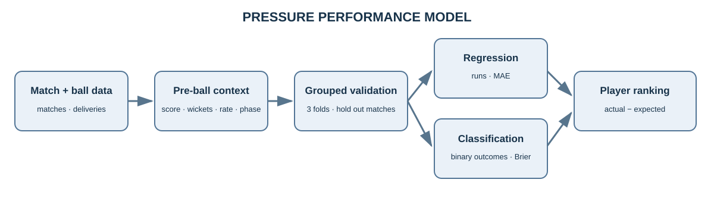
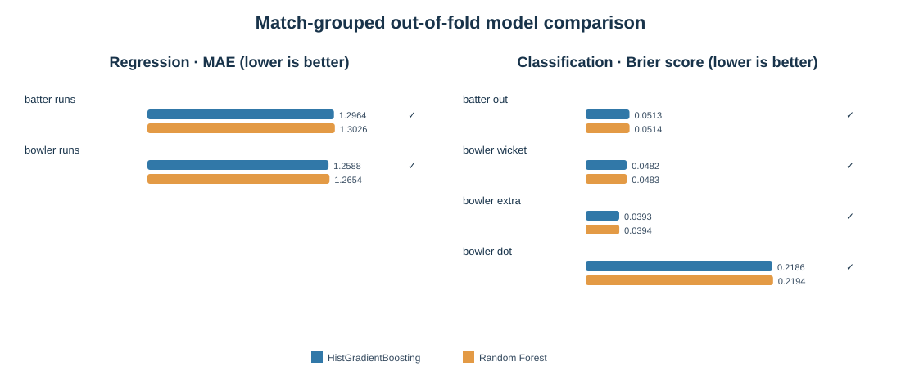

# T20 pressure performance rankings

## Data and model

The rankings cover 883 supplied T20/T20I matches and 200,999 deliveries from 2022 onward: 371 IPL, 30 other T20, and 482 T20I. Player identity uses the supplied player ID. No T20 World Cup records are included.

The pandas and scikit-learn pipeline is in [src/player_rankings.py](src/player_rankings.py); Section 13 of [src/pressure_analytics.ipynb](src/pressure_analytics.ipynb) calls the same ranking implementation. Run-count outcomes use regression (HistGradientBoostingRegressor and RandomForestRegressor); binary dismissal, wicket, extra, and dot outcomes use classification (HistGradientBoostingClassifier and RandomForestClassifier). Three-fold GroupKFold validation holds out complete matches. Regression is compared by MAE and classification probabilities by Brier score. The feature set includes bowling style and the extreme endgame chase indicator.

The SVG figures are also saved separately under `pressure_outputs/` for insertion into documentation.

## Batter pressure and spin measures

All match state is calculated before the delivery. Legal balls remaining uses revised innings length and counts legal balls because `over_ball_num` advances on wides/no-balls. Shared pressure includes the final five overs, a chase requiring 16+ runs per over, 5+ wickets lost in a chase, or a knockout. A separate endgame chase signal requires more than 18 runs per over with at most 12 legal balls left; its ranking component measures above-expected batter runs in winning chases. Semi-finals and finals are explicitly included using the match stage label; the supplied knockout flag also includes qualifiers and eliminators.

Batter-specific signals include first-innings recovery in the first half after 2+ wickets fall; powerplay-collapse recovery in overs 1–6 after 2+ wickets fall; and middle-order pressure for batting positions 4–6 under shared pressure or after 2+ wickets fall. These run rates are compared with model expectations and shrunk with a 60-ball prior.

Middle-order spin strike rate is the batter's runs per 100 balls faced against deliveries labeled `Spin`, while batting positions 4–6, across all innings. The rank component uses context-adjusted runs above expectation per 100 spin balls, a 60-ball prior, and requires at least 30 spin balls. It contributes 5% of the batter score. Non-middle-order players receive a neutral value. The dashboard/report also show the raw spin strike rate and spin-ball sample.

Opener standards: an opener bats at positions 1–2 in at least half of their innings, with at least 10 opening innings. At least half of those innings must include 30+ runs at SR ≥160 and at least half of runs from fours/sixes. This is a 5% component and an eligibility condition for openers. Top-order standards also require at least 10 innings, average >30, boundary run share >50%, overall SR ≥150, and 150+ SR in at least half of 6+ ball innings.

Batting weights are pressure runs above expectation 25%, dismissals avoided 15%, pressure-match consistency 10%, last-five-over innings at SR ≥160 5%, successful endgame chase batting 10%, first-innings recovery 5%, powerplay recovery 10%, middle-order pressure 5%, middle-order spin handling 5%, opener consistency 5%, and sample volume 5%. The endgame component uses winning-chase runs above expected per 100 balls with a 12-ball prior and is neutral below six balls. Bowling weights are runs saved 30%, wickets above expectation 20%, wides/no-balls avoided 15%, dots above expectation 10%, powerplay set-partnership wickets above expected 5%, death-over wickets above expected against a set batter 5%, death-over runs saved against a set batter 10%, and sample volume 5%. Scores are relative indices, not probabilities.

A new bowler-specific powerplay signal counts legal-ball opportunities in overs 1–6 when the stand is already 30+ runs and the striker has scored 20+ runs from at least 12 balls in that partnership. A bowler-credited dismissal is a partnership break; run outs and other non-bowler dismissals are excluded. Breaks are compared with the out-of-fold expected wicket probability and reported as residual breaks per 100 qualifying balls, shrunk with a 30-ball prior. The component is neutral below six qualifying balls. Across the supplied pool, the signal covers 4,176 qualifying legal-ball opportunities and 216 bowler-credited breaks.

Death-over settled-batter pressure isolates the last five overs when the batting side has at least six wickets in hand, the partnership has reached 30+ runs, and the striker has scored 20+ runs from at least 12 balls in that stand. The rank rewards wickets above expected (5%) and runs saved versus expected (10%) on these legal deliveries, both per 100 balls with a 30-ball prior. Raw death-over economy and wicket counts are also reported; at least six qualifying balls are required for non-neutral component scores.

## Top 10 batters

| Rank | Batter | Score | Winning endgame balls | Runs on those balls | Winning endgame matches |
|---:|---|---:|---:|---:|---:|
| 1 | Tim David (ID 6396) | 0.806 | 2 | 10 | 1 |
| 2 | Shreyas Iyer (ID 3647) | 0.801 | 0 | 0 | 0 |
| 3 | Suryakumar Yadav (ID 1699) | 0.797 | 0 | 0 | 0 |
| 4 | Heinrich Klaasen (ID 4260) | 0.731 | 0 | 0 | 0 |
| 5 | Naman Dhir (ID 37052) | 0.719 | 3 | 11 | 1 |
| 6 | Sherfane Rutherford (ID 6725) | 0.698 | 0 | 0 | 0 |
| 7 | Glenn Phillips (ID 4853) | 0.680 | 1 | 6 | 1 |
| 8 | Cameron Green (ID 5939) | 0.680 | 0 | 0 | 0 |
| 9 | Daryl Mitchell (ID 4106) | 0.678 | 0 | 0 | 0 |
| 10 | Marcus Stoinis (ID 2639) | 0.662 | 1 | 6 | 1 |

Endgame counts require a successful chase with more than 18 runs per over required and at most 12 legal balls left. The component uses runs above context expectation and is neutral below six qualifying balls. Across the player pool, this condition covers 70 balls; David Miller (10), Rinku Singh (8), and Rahul Tewatia (6) meet the six-ball minimum.

## Top 10 bowlers

| Rank | Bowler | Score | Pressure balls | Pressure wickets | Pressure economy | Dot-ball % |
|---:|---|---:|---:|---:|---:|---:|
| 1 | Jason Holder (ID 2633) | 0.744 | 757 | 59 | 9.75 | 28.4% |
| 2 | Jofra Archer (ID 3298) | 0.733 | 422 | 31 | 9.61 | 30.6% |
| 3 | Sunil Narine (ID 781) | 0.707 | 361 | 22 | 6.71 | 36.8% |
| 4 | Josh Hazlewood (ID 830) | 0.666 | 524 | 41 | 9.15 | 35.5% |
| 5 | Dushmantha Chameera (ID 2399) | 0.655 | 403 | 27 | 9.32 | 34.0% |
| 6 | Varun Chakravarthy (ID 6256) | 0.638 | 573 | 43 | 8.17 | 40.1% |
| 7 | Rashid Khan (ID 4722) | 0.624 | 884 | 77 | 8.08 | 34.7% |
| 8 | Eshan Malinga (ID 39657) | 0.620 | 393 | 28 | 8.87 | 33.6% |
| 9 | Adam Zampa (ID 2636) | 0.608 | 277 | 30 | 8.53 | 34.3% |
| 10 | Jasprit Bumrah (ID 2933) | 0.600 | 665 | 46 | 7.43 | 35.5% |

## Diagnostics and source limits

- batter_runs: selected HistGradientBoosting; HistGradientBoosting MAE=1.2964, RandomForest MAE=1.3026
- batter_out: selected HistGradientBoosting; HistGradientBoosting Brier=0.0513, RandomForest Brier=0.0514
- bowler_runs: selected HistGradientBoosting; HistGradientBoosting MAE=1.2588, RandomForest MAE=1.2654
- bowler_wicket: selected HistGradientBoosting; HistGradientBoosting Brier=0.0482, RandomForest Brier=0.0483
- bowler_extra: selected HistGradientBoosting; HistGradientBoosting Brier=0.0393, RandomForest Brier=0.0394
- bowler_dot: selected HistGradientBoosting; HistGradientBoosting Brier=0.2186, RandomForest Brier=0.2194
Playing-XI coverage is 99.9% for batting order and 99.9% for bowlers; team directory coverage is 100%. Extra-run amounts are incomplete; some multi-run extras may be underestimated. No T20 World Cup records appear in the supplied data.

Reproduce with `python3 src/player_rankings.py` from the project root, or execute Section 13 in the notebook.
